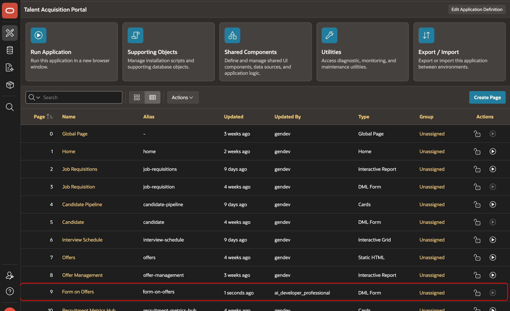
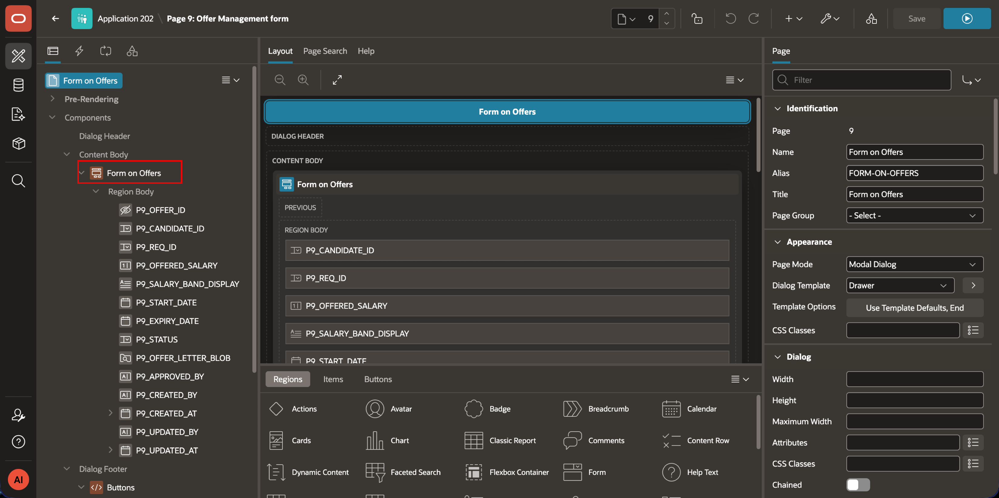
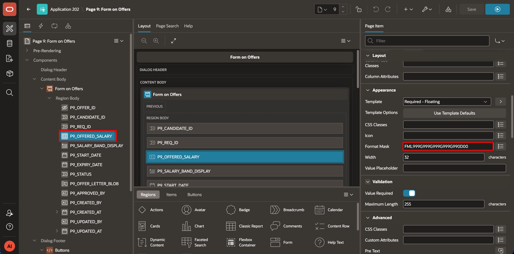
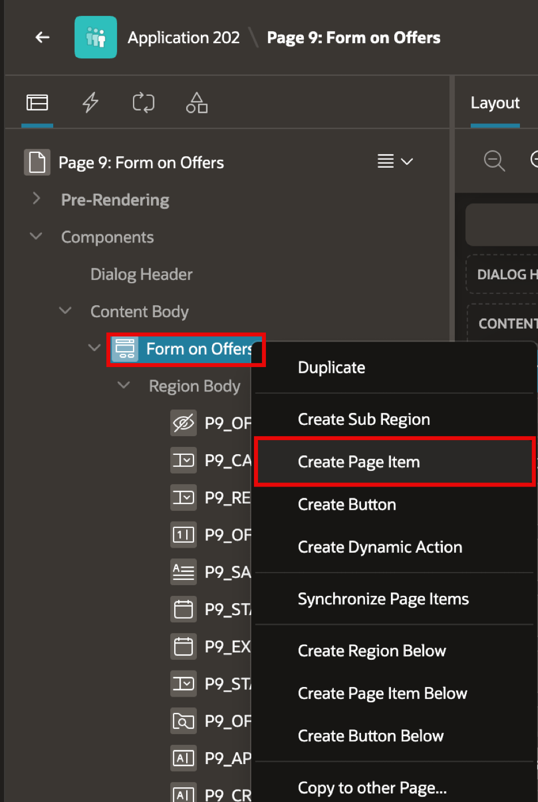
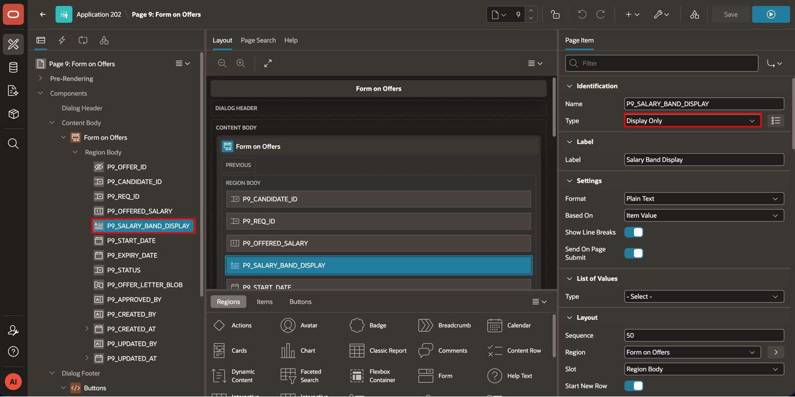
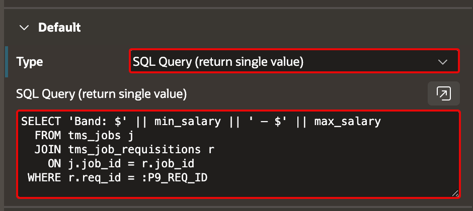
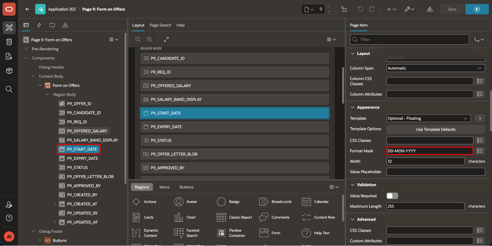
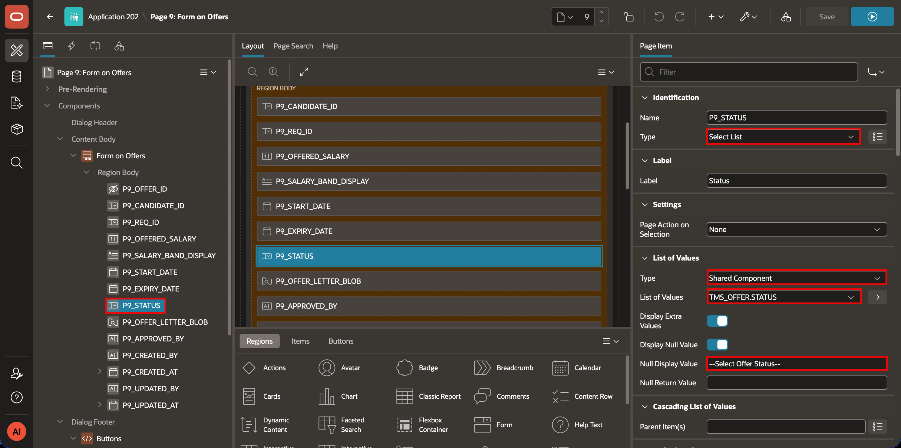
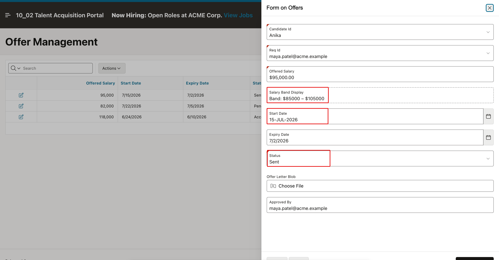

# Lab 2: Build the Offer Management Form

## Introduction

The Offers page from Module 5 needs consistent dates, values, and offer statuses. Configure the form and add a Display Only salary-band item. In Oracle APEX, a Display Only item displays non-enterable text.

Estimated Workshop Time: 5 minutes

### Objectives

In this lab, you will learn how to:

- Set the offered-salary number format.

- Display the selected requisition’s salary band.

- Configure date and status page items.

## Task 1: Open the Form on Offers

1. In TAP **App Builder**, open the **Form on Offers** page created from the `TMS_OFFERS` table in Module 5.

    

2. In the left pane, select the **Form on Offers** region.

    

## Task 2: Configure the offer fields

> **Note:** The examples use form page `9` and item names beginning with `P9_`. If your form has a different page number, use its item names throughout this task.

1. Select the **P9\_OFFERED\_SALARY** page item. In the Property Editor, enter/select the following:

    - Appearance > Format Mask:  **FML999G999G999G999G990D00**

    

2. Right-click **Form on Offers** and select **Create Page Item**.

    

3. In the **Property Editor**, enter/select the following:

    - Under Identification:

        - Name: **P9\_SALARY\_BAND\_DISPLAY**

        - Type: **Display Only**

    - Under Default:

        - Type: **SQL Query**

        - SQL Query: Copy and paste the following query:

            ```sql
                <copy>SELECT 'Band: $' || min_salary || ' – $' || max_salary
                  FROM tms_jobs j
                  JOIN tms_job_requisitions r
                    ON j.job_id = r.job_id
                 WHERE r.req_id = :P9_REQ_ID
                </copy>
                ```

    *Note: If your requisition item has a different name, replace `:P9_REQ_ID` with that item name.*

    

    

4. Select **P9\_START\_DATE** page item. In the Property Editor, enter/select the following:

    - Appearance > Format Mask: **DD-MON-YYYY**

    

5. Select **P9\_STATUS** page item. In the Property Editor, enter/select the following:

    - Identification > Type: **Select List**.

    - Under List of Values:

        - Type: **Shared Component**

        - List of Values: **TMS\_OFFER.STATUS**

        - Null Display Value: **--Select Offer Status--**

    

6. Click **Save and Run**.

7. Select an offer record to confirm that the salary band, date picker, and status list display correctly.

    

## Acknowledgements

- **Author -** Aravind Madhavan, Senior Product Manager

- **Last Updated By/Date** - Aravind Madhavan, Senior Product Manager, July 2026
