# Lab 4: Build the ESS Leave Request Form

## Introduction

Employees need a clear form to request leave and review prior requests. Build the ESS Leave Request form and add a leave-history report.

Estimated Workshop Time: 5 minutes

### Objectives

In this lab, you will learn how to:

- Build the Leave Request form on `TMS_LEAVE_REQUESTS`.

- Configure employee, leave-type, status, and approver page items.

- Add the My Leave History interactive report.

## Task 1: Create the Leave Request form

1. In ESS **App Builder**, open the **Leave Request** page in **Page Designer**.

    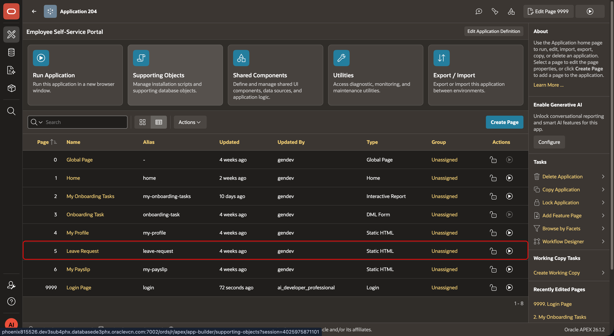

2. In the left pane, right-click **Body** and select **Create Region**.

    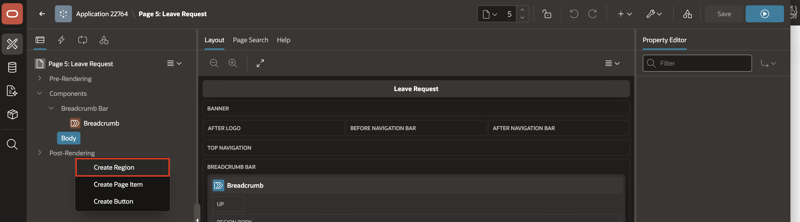

3. In the Property Editor, enter/select the following:

    - Under Identification:

        - Name: **Leave Request Form**

        - Type: **Form**

    - Source > Table Name: **TMS\_LEAVE\_REQUESTS**

    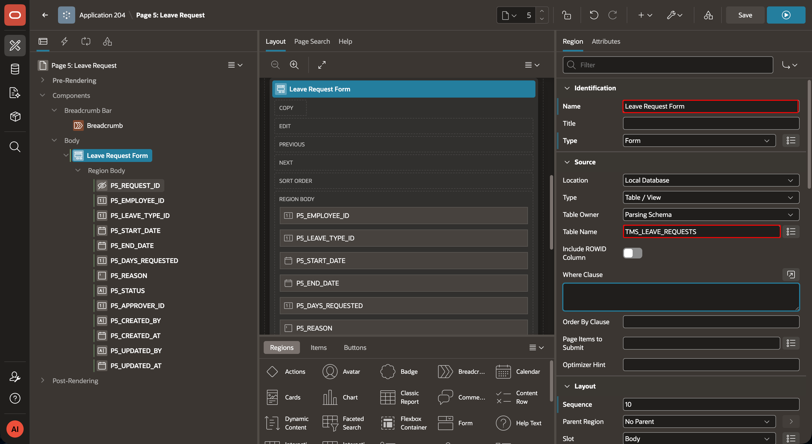

4. Right-click **Leave Request Form** region and select **Create Button**.

5. In the Property Editor, enter/select the following:

    - Identification > Button Name: **SUBMIT_LEAVE**

    - Layout > Slot: **Create**

    - Behavior > Action: **Submit Page**

    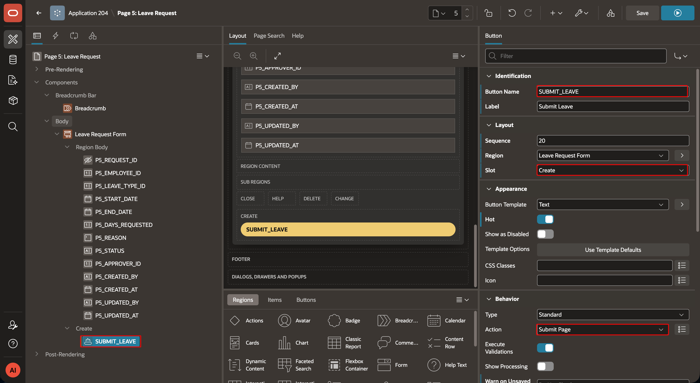

6. Again, right-click **Leave Request Form** region and select **Create Button**.

7. In the Property Editor, enter/select the following:

    - Identification > Button Name: **CANCEL**

    - Layout > Slot: **Close**

    - Under Behavior:

        - Action: **Redirect to a Page in this Application**

        - Target: Enter/select the following:

            - Page: **1**

            Click **OK**.

    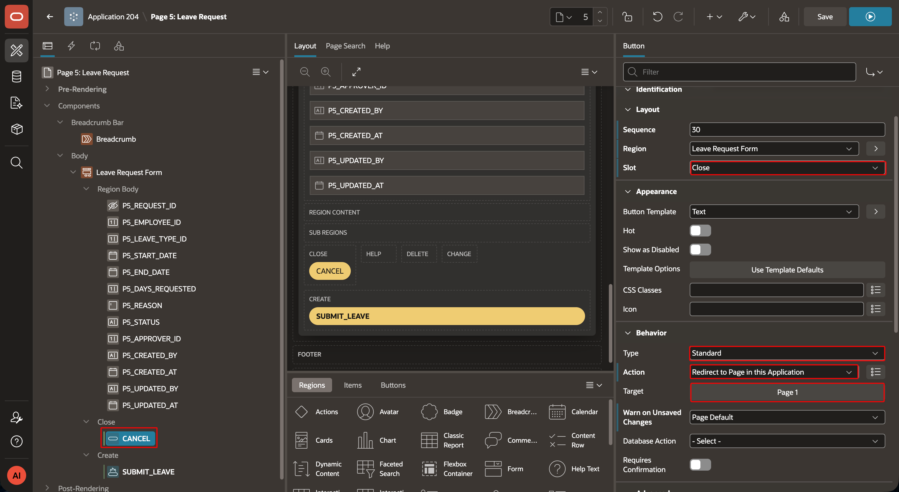

    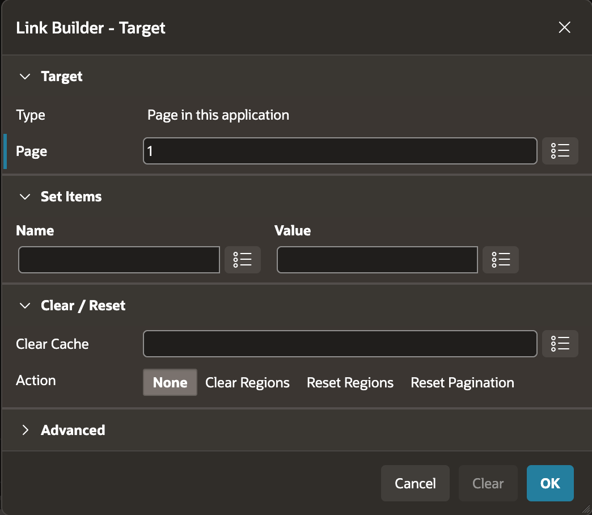

## Task 2: Configure the form items

> **Note:** The examples use page `5` and the `P5_` item prefix. If your Leave Request page has a different number, use its item names and update the report query accordingly.

1. In the left pane, select **P5\_EMPLOYEE\_ID** page item. In the Property Editor, enter/select the following:

    - Identification > Type: **Display Only**.

    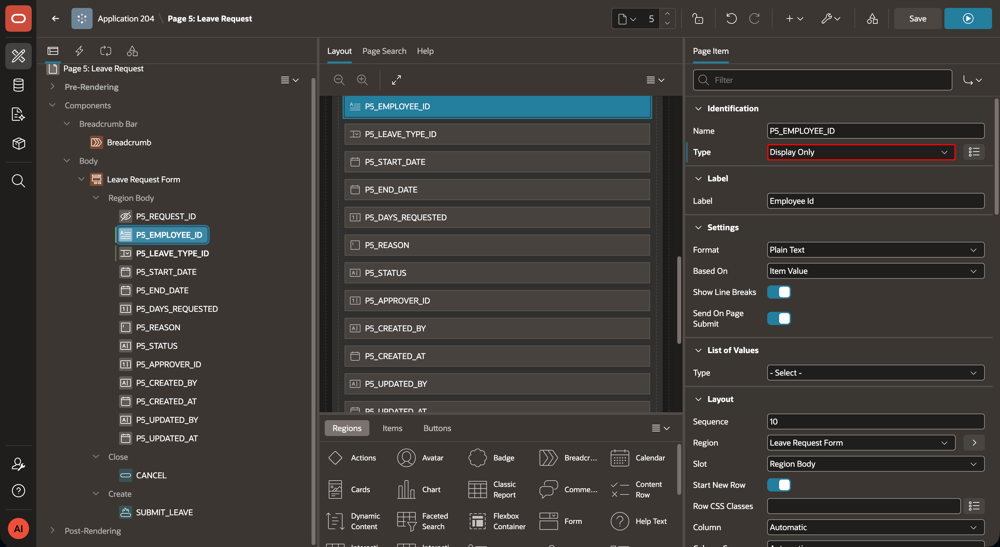

2. Select **P5\_LEAVE\_TYPE\_ID** page item. In the Property Editor, enter/select the following:

    - Identification > Type: **Select List**

    - Under List of Values:

        - Type: **Shared Component**

        - List of Values: **TMS\_LEAVE.TYPES**

        - Null Display Value: **---Select Leave Type---**

    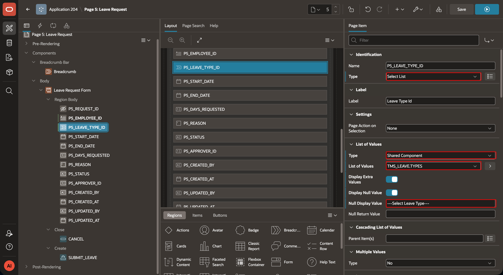

3. Select **P5_STATUS** page item. In the Property Editor, enter/select the following:

    - Identification > Type: **Hidden**

    - Under Default:

        - Type: **Static**

        - Static Value: **Submitted**

    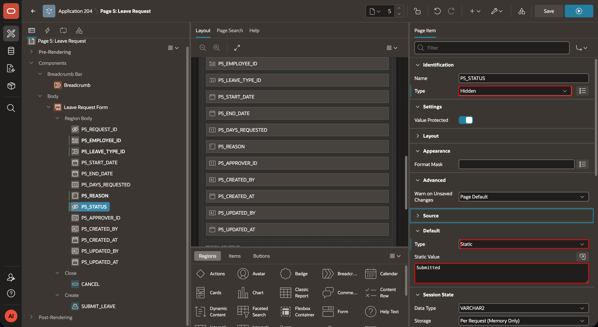

4. Select **P5\_APPROVER\_ID** page item. In the Property Editor, enter/select the following:

    - Identification > Type: **Hidden**

    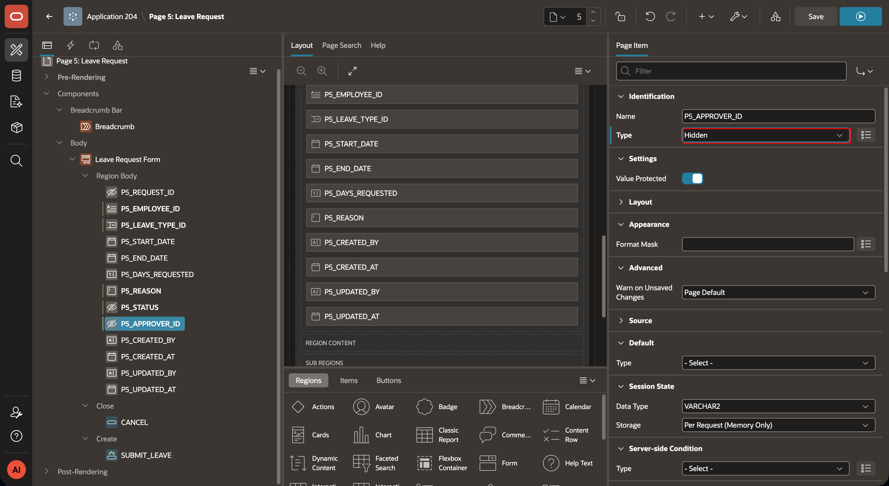

5. In the left pane, select `P5_CREATED_BY`, `P5_CREATED_AT`, `P5_UPDATED_BY`, and `P5_UPDATED_AT` page items.

    - Hold **Ctrl** on Windows or **Command** on macOS to select multiple items.

    - Right-click the selected items and choose **Delete**. Confirm deletion if prompted.

    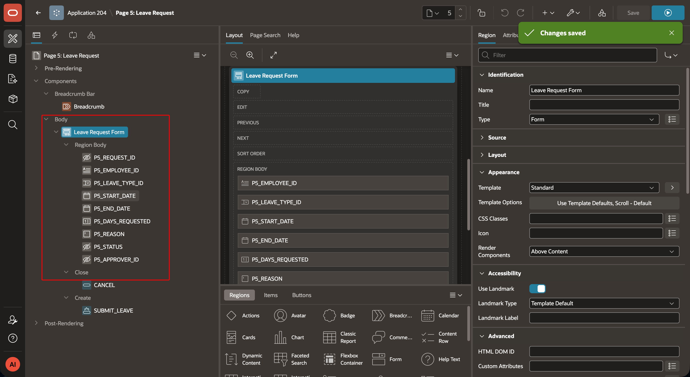

## Task 3: Add the My Leave History report

1. In the left pane, right-click **Body** and select **Create Region**.

    

2. In the Property Editor, enter/select the following:

    - Under Identification:

        - Name: **My Leave History**

        - Type: **Interactive Report**

    - Under Source:

        - Type: **SQL Query**

        - SQL Query: Copy and paste the below SQL query:

        ```sql
        <copy>SELECT leave_type_id,
            start_date,
            end_date,
            days_requested,
            status
        FROM tms_leave_requests
        WHERE employee_id = :P5_EMPLOYEE_ID
        ORDER BY start_date DESC</copy>
        ```

        - Page Items to Submit: **P5\_EMPLOYEE\_ID**

    - Set the region **Sequence** after the **Leave Request Form** so that the report appears below the form.

    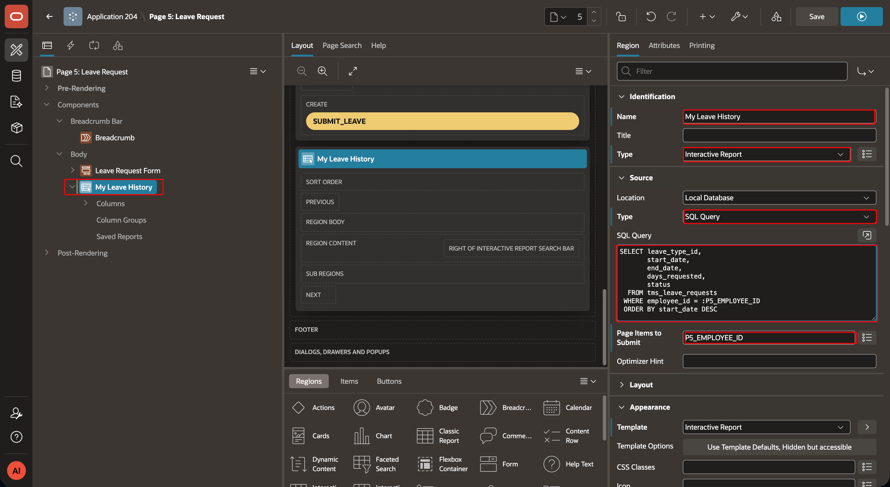

3. Click **Save and Run**.

4. Confirm that the form displays the configured page items and the report displays leave requests for the current employee.

    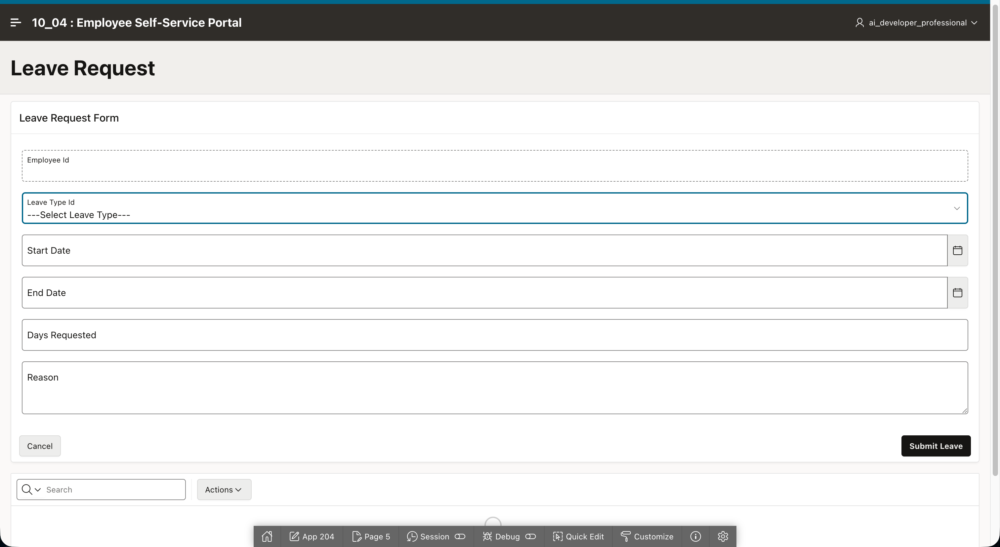

## Acknowledgements

- **Author -** Aravind Madhavan, Senior Product Manager.
- **Last Updated By/Date** - Aravind Madhavan, Senior Product Manager, July 2026
