# Lab 1: Add Bulk Validations and Make TAP Buttons More Prominent

## Introduction

TAP is already installed after the complete application import in Module 23. Add bulk validations to recruitment forms, then make buttons more prominent across the application. Review the changes and import a page through SQL Developer for VS Code. Then import the complete application to apply the remaining changes.

Estimated Workshop Time: 25 minutes

### Objectives

In this lab, you will learn how to:

- Add bulk validations to the existing TAP application.
- Edit buttons across the application.
- Import the pages that you updated.

### Prerequisites

The **single-file import** feature requires **Oracle APEX 26.2 or later** and a TAP project exported from APEX 26.2 or later.

On **APEX 26.1**, follow the editing tasks, then skip the single-file import in Task 4. Use **Import Application** in Task 5, as learned in Module 23.

## Task 1: Check the TAP Project and Export Version

1. Open the TAP APEXlang project from Module 23 in VS Code:

    - In **Explorer**, expand **applications**.
    - Locate the **talent-acquisition-portal** folder.

    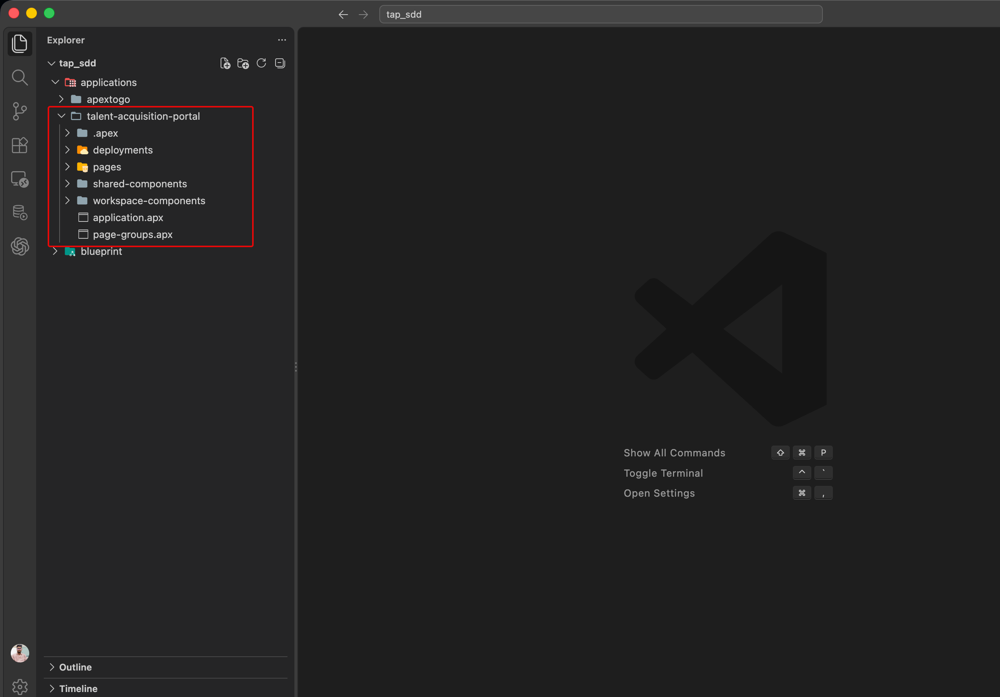

2. Check the APEXlang export version:

    - Open `talent-acquisition-portal/.apex/apexlang.json`.
    - Check the **mmdVersion** value. Single-file import requires a version of `26.2` or later.

    An APEX 26.1 export might contain:

    ```json
    {
        "mmdVersion": "26.1.0+3102"
    }
    ```

    An APEX 26.2 export might contain:

    ```json
    {
        "mmdVersion": "26.2.0+3479"
    }
    ```

    The build number after `+` may differ in your environment.

    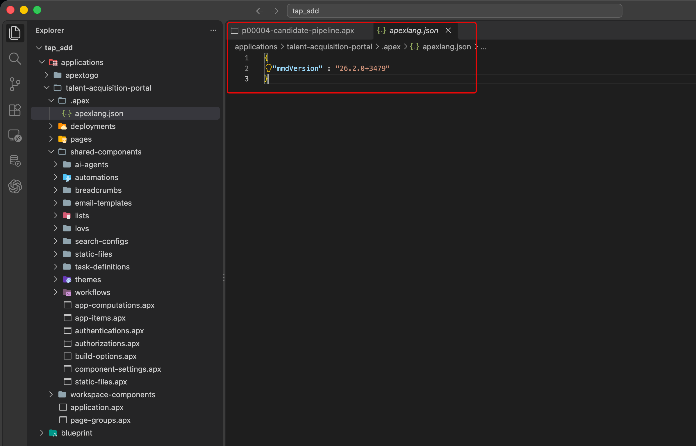

## Task 2: Add Bulk Validations

1. Open Codex in VS Code:

    - Click the **Codex** icon in the Activity Bar.
    - Open the chat.

    - Use the TAP project and the Oracle APEXlang skills configured in **Module 23**.

    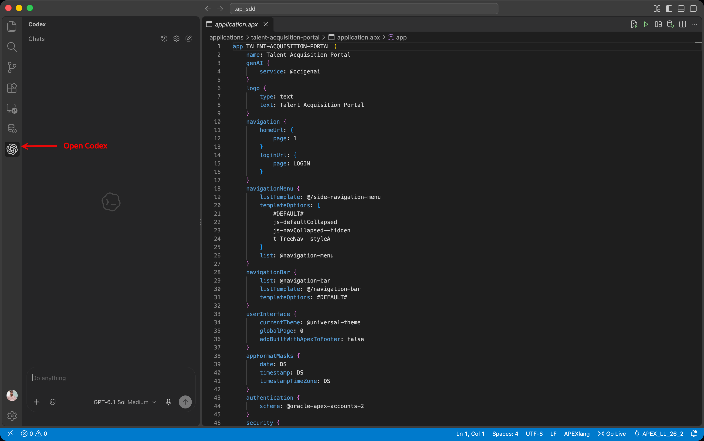

2. Submit the validation prompt for the TAP project:

    - Type `@talent-acquisition-portal` to add the TAP folder to the chat context.
    - Paste the following prompt:

    ```text
    <copy>
    Add validations to the Candidate, Job Requisition, and Offer forms in TAP.
    Candidate names and email must not be blank. Headcount must be a positive
    whole number, and offered salary must be greater than zero.
    </copy>
    ```

    - Click **Send**.

    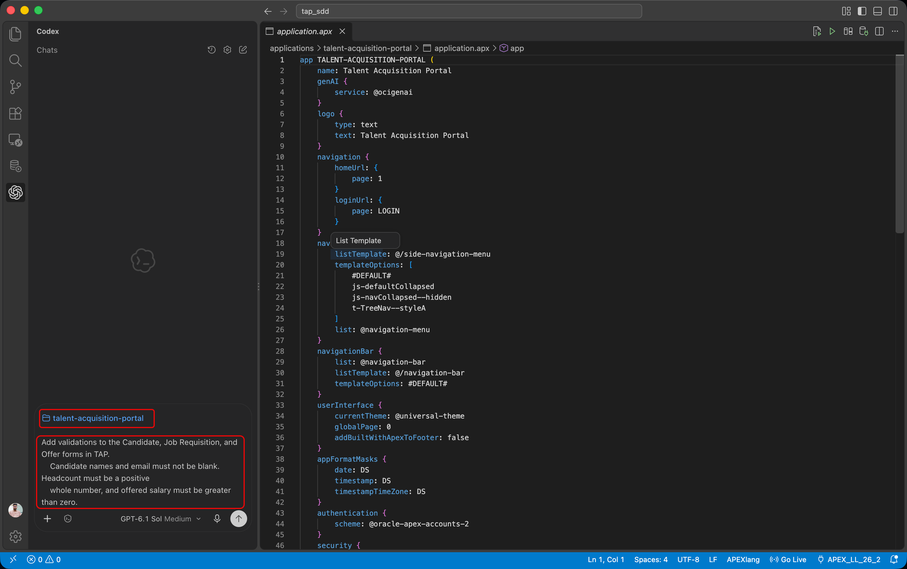

3. Review Codex's response:

    - Review the response.
    - Click **View changes** to inspect the edited page files.

    - Confirm that **Codex** added validations to the existing forms.
    - Confirm that it used the correct items.

    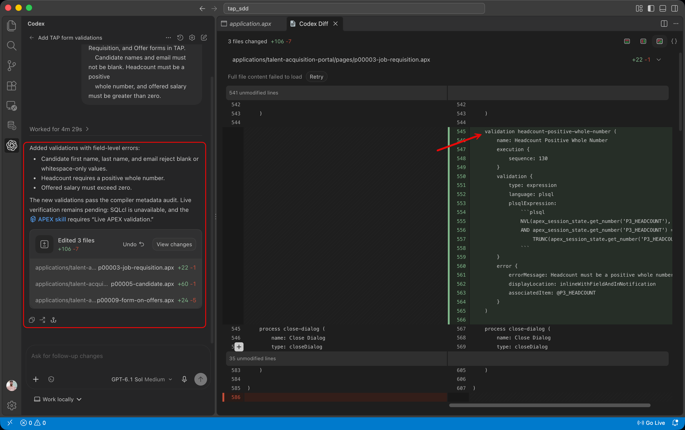

4. Review the headcount validation:

    - Open `pages/p00003-job-requisition.apx`.
    - Review the validation and its error message.

    - Keep the edits local for now.
    - Test the validations after importing the page.

    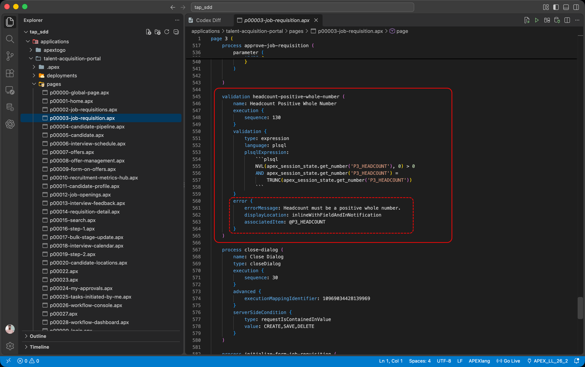

## Task 3: Make Buttons More Prominent Across TAP

1. In the same **Codex** chat, submit this prompt:

    ```text
    <copy>
    Identify all the buttons across all the pages and make them more prominent in line with the theme.
    </copy>
    ```

    - Click **Send**.

    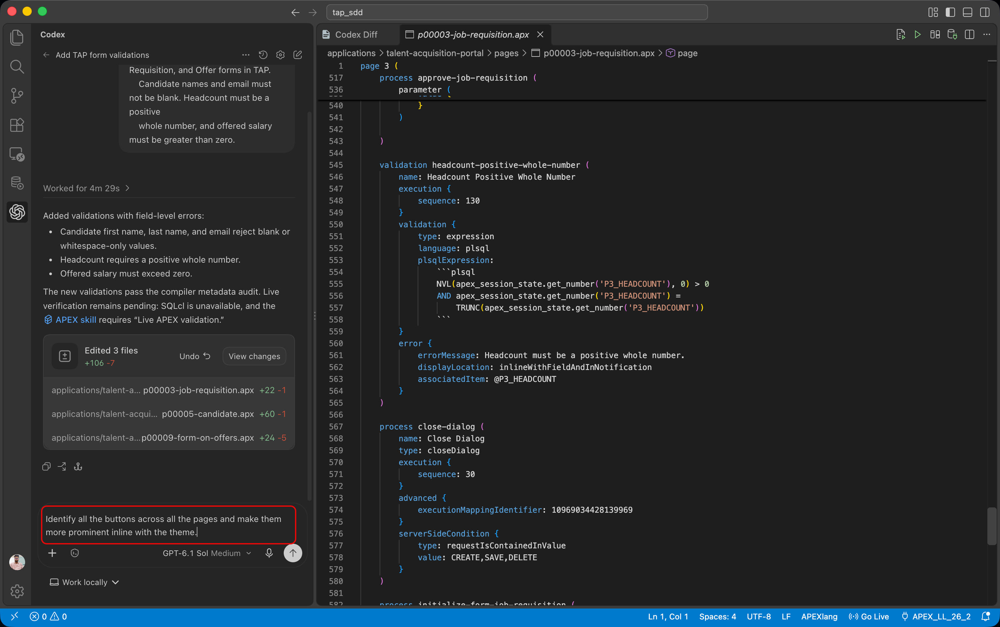

2. Review the response while **Codex** identifies the buttons and proposed appearance changes.

    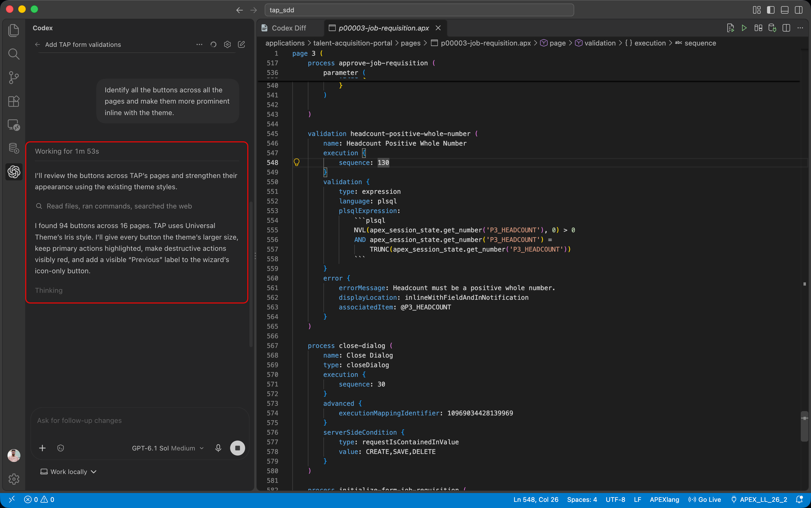

3. Review Codex's completed button updates:

    - Wait for **Codex** to finish updating the buttons.
    - Review its completion summary.

    - This example identifies **94 buttons across 16 pages** and applies styles from the existing theme. Your totals may differ.

    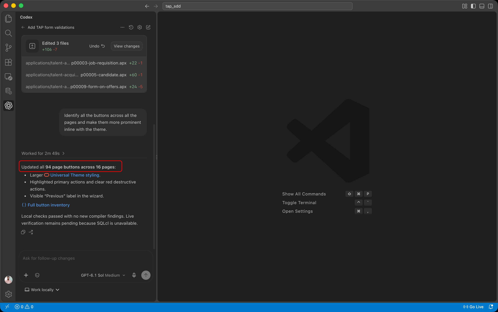

4. Review the button appearance settings:

    - Open an edited page.
    - Review its button appearance settings.

    - Confirm that button actions and conditions remain intact.
    - Check the visual result after import.

    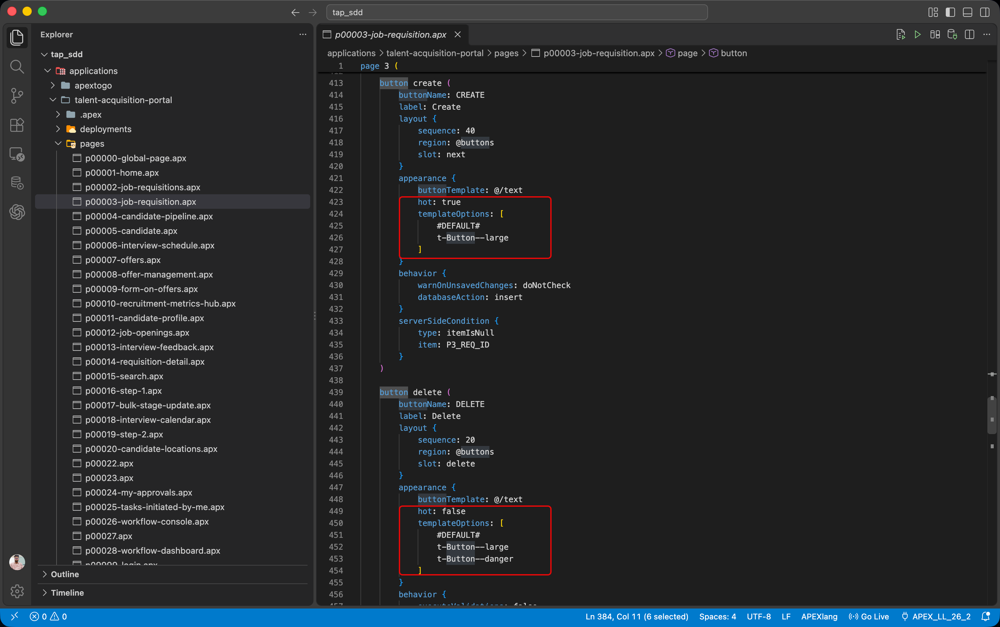

## Task 4: Compare the Changes and Import One Page

1. Open an edited `.apx` page file.

    - Click **Compare with APEX Application** in the editor toolbar.

    - Review the differences between your local project and TAP in the connected workspace.

    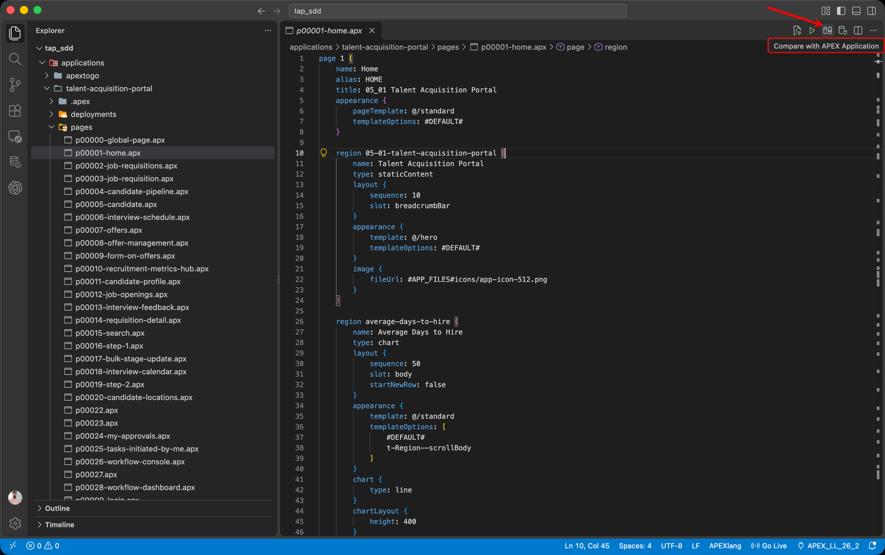

2. In **APEXlang Differences**, review the files marked **modified**.

    - Confirm that the connection and application shown at the top are your intended targets.
    - Reconcile any unexpected differences before import.

    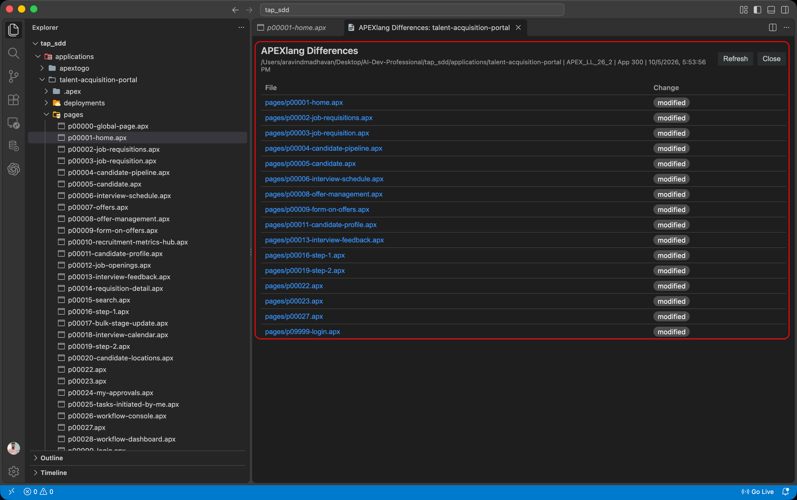

3. Click `pages/p00003-job-requisition.apx` in the differences list to open the **Remote ↔ Local** comparison.

    - Review the button changes and added validations before importing.

    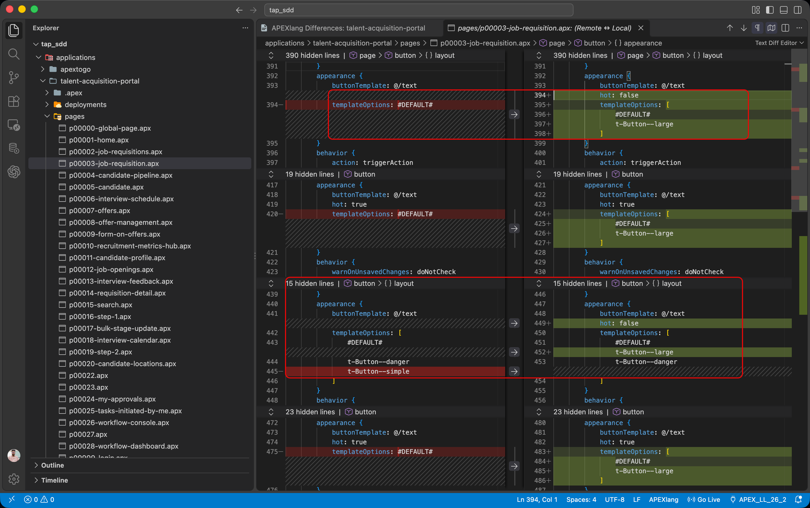

4. Check for APEXlang errors:

    - Select **View > Problems**.
    - Resolve any reported errors.

    - Review warnings before proceeding.

    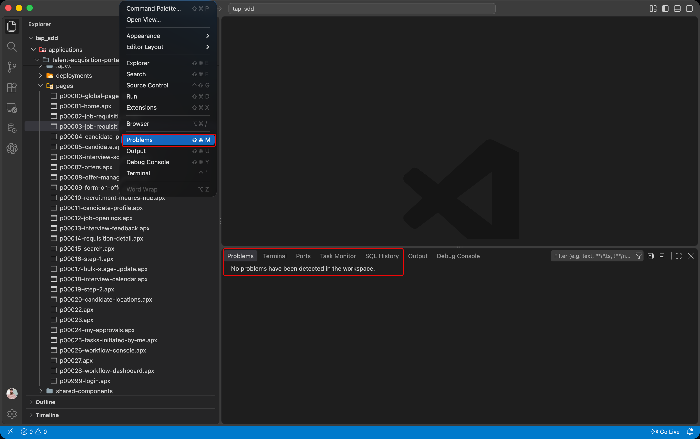

5. Import the edited Job Requisition page:

    - Open `pages/p00003-job-requisition.apx` in the regular editor tab.
    - Save your edits.

    - Confirm the selected connection and target Application ID.

    - Click **Import File** in the editor toolbar.

    - Wait for the **File successfully imported** message.

    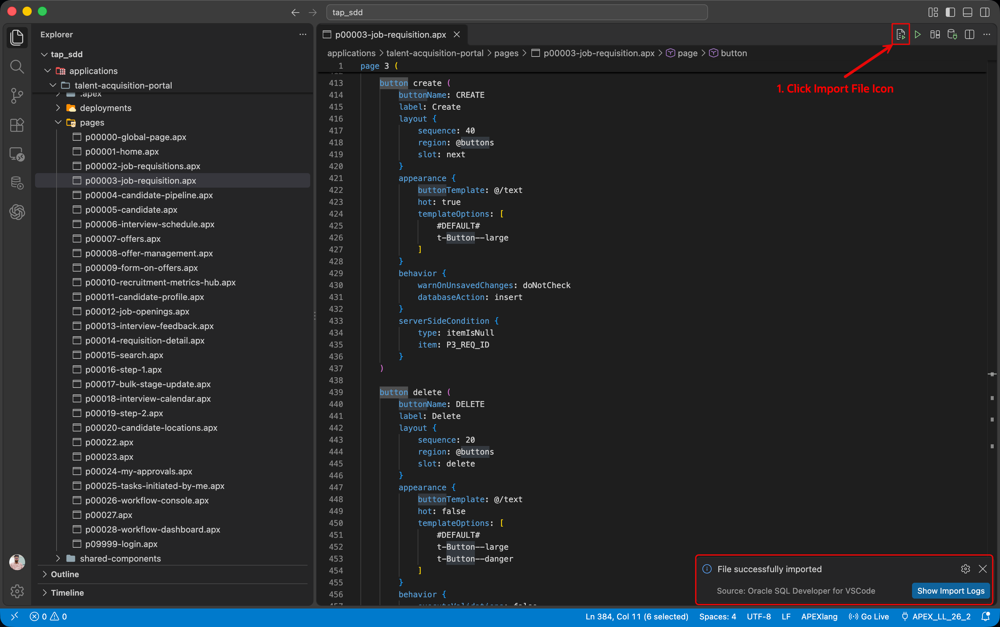

    > **Note:** **Import File** imports only the open file.

6. Test the **Job Requisition** form:

    - Run TAP.
    - Open **Job Requisitions**.
    - Select the **Job Requisition** form.

    - Enter `-1` in **Headcount**.
    - Click **Create**.

    - Confirm that **Headcount must be a positive whole number.** appears below the field and in the notification.
    - Correct the value.
    - Verify that valid data passes the check.

    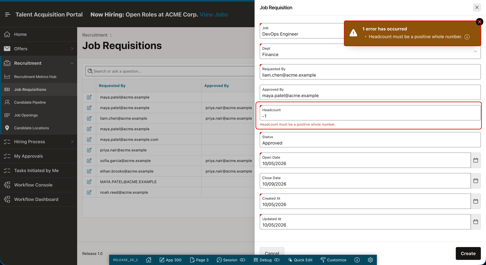

## Task 5: Import the Complete Application and Verify the Remaining Changes

1. Import the remaining button updates. This example has 16 modified files:

    - Save your edits.
    - Click **Import Application** in the editor toolbar.

    - This imports the entire application into the connected workspace.

2. Wait for the **Application successfully imported** message.

    - If the import reports an error, click **Show Import Logs**.
    - Correct the reported issue.
    - Retry the import.

    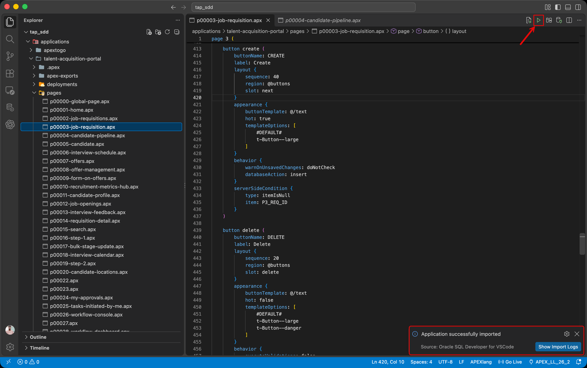

3. Verify the updated buttons in TAP:

    - Run TAP.
    - Review the affected pages.
    - On **Job Requisition**, check **Cancel**, **Delete**, and **Apply Changes**.

    - Confirm that the buttons are more prominent and still perform their expected actions.

    - Use a disposable record when testing **Delete**.

    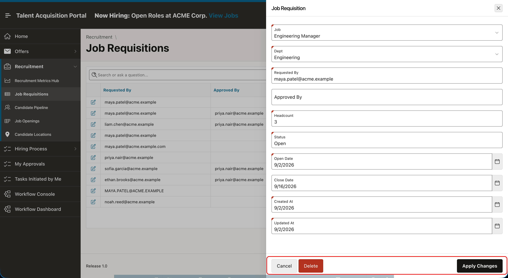

4. Test the validations on the other updated forms:

    - Leave the Candidate name blank and submit the form.
    - Confirm that validation fails.
    - Leave the Candidate email address blank and submit the form.
    - Confirm that validation fails.
    - Enter an offered salary of zero or less and submit the form.
    - Confirm that validation fails.
    - Correct the invalid values.
    - Confirm that valid submissions succeed.

    - **Try More Changes:**

    - Lab 4 provides optional prompts for TAP and ESS.
    - Extend the same edit, review, import, and test workflow to other validations and page improvements.

## Acknowledgements

- **Author** - Aravind Madhavan, Senior Product Manager, Oracle
- **Last Updated By/Date** - Aravind Madhavan, October 2026
